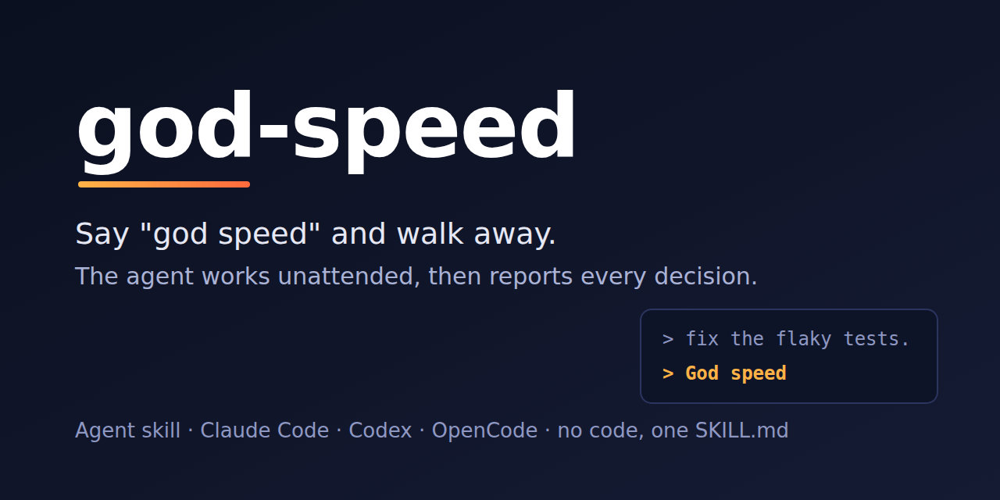

<div align="center">



# god-speed

**Claude Code, Codex & OpenCode skill: say "god speed" and the agent asks only the forks that are costly to get wrong, then works unattended and reports every decision**

[](SKILL.md) [](LICENSE) [](SKILL.md) [](SKILL.md)

[Install](#install-the-skill) · [Use](#use-it) · [Safety](#decisions-not-permissions) · [Contributing](CONTRIBUTING.md)

</div>

## See it run

A real run, Claude Code in print mode, with the skill installed:

```text
> Create notes.txt here containing a three-line haiku about autumn.
>
> God speed

  Skill(god-speed)
  Write(notes.txt)
  Bash(wc -l notes.txt && cat notes.txt)

I created notes.txt in the working directory. I checked it with `wc -l` and
`cat`, and it has exactly three lines.

Decisions
- Location: "here" meant the primary working directory, since you gave no other path.
- Syllables: I wrote it as a traditional 5-7-5 haiku so it reads as a real one.
- Trailing newline: the file ends with a newline, which is the usual text-file convention.
- Git: I didn't stage or commit it, because you didn't ask for that.

Nothing is left undone.
```

Nothing in this request was costly to get wrong, so no question came back, no status update, and nothing needed a reply. There was one report at the end, and each judgment call in it can be overturned.

## Why

You hand an agent a long task and step away. You come back to *"Should I use approach A or B?"*, twenty minutes old, with nothing done. Or three check-ins in a row, then a question the agent could have answered from the codebase. Or the opposite: everything done, built on a choice you would have overturned with one word.

Say the phrase and, for that request:

- **One question round, up front, only for the forks that are costly to get wrong.** Before its first edit the agent lists every fork the work will hit and asks you at most four, in one round, each with its own context and a recommended option. When nothing qualifies, it asks nothing.
- **No waiting on you after that.** The agent makes every other judgment call itself and writes each one down.
- **Finished, not half-done.** Every part of the task is carried to done and verified by running tests, builds and real output.
- **No chatter.** There is no interim status, no check-in and no "shall I continue?".
- **Stops only on a real blocker,** after finishing everything that does not depend on it.
- **One report you can audit:** what was done, how it was verified, the costly forks it decided on its own listed first with how to flip them, then every other decision taken for you, each with its reason.

## Install the skill

It is one Markdown file, [`SKILL.md`](SKILL.md), with no code, no dependencies and no configuration. Clone it into the skills folder your agent reads, then start a new session:

| Agent | Command |
| --- | --- |
| Claude Code | `git clone https://github.com/rezzminator/god-speed ~/.claude/skills/god-speed` |
| Codex CLI | `git clone https://github.com/rezzminator/god-speed ~/.agents/skills/god-speed` |
| OpenCode | either path above: OpenCode reads both |
| [Professor](https://github.com/rezzminator/professor) | `pfm install --yes` installs it for every account and engine |

<details>
<summary>One project only, update, remove</summary>

- One project: clone it into that project's `.claude/skills/god-speed` or `.agents/skills/god-speed` instead.
- Update: `git -C ~/.claude/skills/god-speed pull`, or the same command with the path you cloned to.
- Remove: delete that folder.

</details>

## Use it

End the prompt with the phrase, the way you would sign off a message:

```text
Migrate the settings page to the new form library, fix whatever breaks,
and get the test suite green.

God speed
```

`godspeed` and `god-speed` work too, in any capitalisation.

## What it asks, and what it never asks

A fork is worth a question only when choosing wrong costs a rebuild, a revert or your trust, and nothing you said, your project's rules or the code already settles it:

| Kind of fork | Example question |
| --- | --- |
| Something existing is replaced or dropped | The new mechanism replaces the old one. Remove the old one, or keep it as a fallback? |
| Where a new thing lives | Build it inside the main app, or as its own plugin? |
| A new dependency, service or account | Use the paid API, or the subscription you already have? |
| A contract others build on | A config key, a default threshold, a version scheme |
| A policy you never stated | The agent wants to enforce a ban or a redaction in code |
| A goal with two readings | Is the budget the price alone, or everything included? |
| Your live machine, chats, browser, public name or money | Run the benchmark on your live account, or in a sandbox? |

It never asks about committing, pushing, merging or releasing (those follow your permission rules), names or formatting, or anything you already answered. A costly fork that only shows up mid-run is not asked either: the agent takes the option that is cheapest to reverse, keeps the other one reachable, and lists it first in the report.

## How the trigger works

The skill's `description` tells the agent to load it whenever your prompt says the phrase. The agent reads the skill's rules and follows them for that request. A prompt that only *talks about* the phrase, such as *"what does 'god speed' mean?"*, is answered normally.

Checked on Claude Code 2.1.295 with Sonnet and Opus. The prompt above loaded the skill and asked nothing; the question about the phrase did not load it; a request that changed what an imported constant means asked that one question before the first edit, then ran to the end without another.

## Decisions, not permissions

> [!IMPORTANT]
> God speed hands the agent your decisions, not new permissions. Your project rules, your permission mode and your agent's own safeguards still apply.

If the task would need a destructive or outward-facing step you did not ask for, such as deleting data, force-pushing, publishing, sending a message, spending money, upgrading software or touching your other chats and live services, the agent leaves that step undone. It finishes everything else and lists the held step in the final report for you to approve.

## Help

Open an [issue](https://github.com/rezzminator/god-speed/issues). The most useful report is a prompt where the skill loaded when it should not have, or did not load when it should have, together with your agent, its version and the model.

## Contributing

Pull requests are welcome; read [CONTRIBUTING.md](CONTRIBUTING.md) first. Every line of `SKILL.md` is read on each invocation, so a change should alter the agent's behaviour, not only its wording. Newcomer-sized work is labelled [`good first issue`](https://github.com/rezzminator/god-speed/issues?q=is%3Aissue+is%3Aopen+label%3A%22good+first+issue%22).

## License

[MIT](LICENSE). Built and maintained with [Professor](https://github.com/rezzminator/professor), the discipline layer for Claude Code.
